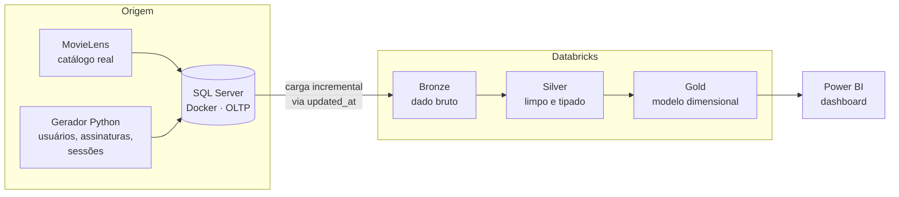
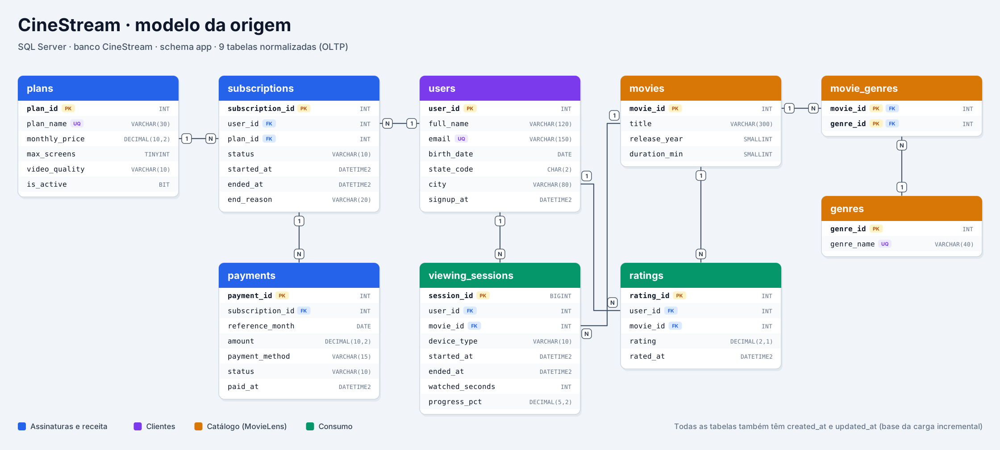

# CineStream Data Platform

Projeto de dados de ponta a ponta para uma **plataforma de streaming fictícia**: de um banco transacional em SQL Server até um dashboard de negócio no Power BI, passando por uma arquitetura medalhão no Databricks.

O projeto foi construído **de trás para frente**: primeiro foi definido o que o dashboard precisa responder, e só depois foram modeladas as tabelas e transformações necessárias.

## Arquitetura



## Perguntas que o dashboard responde

| Página | Indicadores |
|---|---|
| Visão executiva | Assinantes ativos, novos, cancelamentos, churn, MRR, ticket médio, receita por plano |
| Conteúdo | Top filmes por horas assistidas, gêneros, taxa de conclusão, abandono, nota x popularidade |
| Comportamento | Mapa de calor dia x hora, consumo por dispositivo e por estado |
| Retenção *(v2)* | Análise de coorte |

## Modelo da origem



Destaques do modelo:

- **Assinatura = um período em um plano.** Troca de plano fecha a linha atual e abre outra (`end_reason = 'plan_change'`), então o churn conta apenas quem realmente cancelou.
- **`updated_at` em todas as tabelas**, base da carga incremental para o Databricks.
- **Restrições no banco** (`CHECK`, `UNIQUE`, FKs), para que até os dados simulados respeitem as regras de negócio.

## Stack

SQL Server 2022 (Docker) · Python (pandas, SQLAlchemy) · Databricks (PySpark, Delta Lake, Unity Catalog) · Power BI · GitHub

## Estrutura

```
cinestream-data-platform/
├── sql/              # DDL do banco de origem
├── data_generator/   # carga do MovieLens e simulação dos dados
├── databricks/       # notebooks bronze / silver / gold
├── powerbi/          # dashboard (.pbix)
├── docs/             # diagramas e diário de decisões
└── docker-compose.yml
```

## Como reproduzir

**Pré-requisitos:** Docker Desktop, Python 3.11+, [ODBC Driver 18 for SQL Server](https://learn.microsoft.com/sql/connect/odbc/download-odbc-driver-for-sql-server).

1. Suba o SQL Server:
   ```bash
   docker compose up -d
   ```
2. Crie o banco executando `sql/01_create_schema.sql` (conectado em `master`).
3. Baixe o [MovieLens ml-latest-small](https://grouplens.org/datasets/movielens/latest/) e descompacte em `data/movielens/`.
4. Carregue o catálogo:
   ```bash
   python -m venv .venv
   .venv\Scripts\activate          # Windows
   pip install -r requirements.txt
   python data_generator/01_load_movielens.py
   ```

> A senha do `docker-compose.yml` é apenas para o ambiente local de desenvolvimento.

## Progresso

- [x] 0. Definição do dashboard
- [x] 1. Ambiente (SQL Server em Docker)
- [x] 2. Modelagem da origem
- [x] 3. Catálogo de filmes (9.742 filmes do MovieLens)
- [ ] 4. Simulação de usuários, assinaturas e sessões
- [ ] 5. Ingestão no Databricks
- [ ] 6–8. Bronze → Silver → Gold
- [ ] 9. Orquestração e CI/CD
- [ ] 10. Dashboard no Power BI

As decisões de cada etapa estão registradas em [`docs/diario.md`](docs/diario.md).

## Créditos dos dados

Catálogo de filmes: F. Maxwell Harper and Joseph A. Konstan. 2015. *The MovieLens Datasets: History and Context.* ACM Transactions on Interactive Intelligent Systems (TiiS) 5, 4: 19:1–19:19. Usuários, assinaturas, pagamentos e sessões são **dados simulados**.
